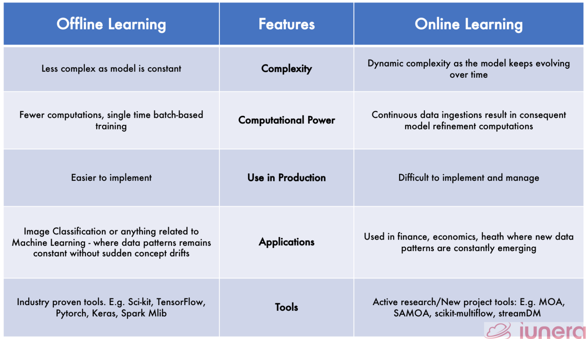

## Batch Machine Learning (Offline Learning)
- The model is trained on an entire dataset or a large fixed batch of data all at once. Once deployed, it does not update automatically when new data arrives; it must be periodically retrained from scratch or fine-tuned.
- To update the model we have to retrain the model on entire dataset again and redeploy the model again on the production.
- There is no incremental training in the case of batch machine learning.

#### Disadvantages of batch machine learning:
- **Lots of data:** Trained on a large dataset at once.
- **Hardware limitations:** Training a batch machine learning model again and again on the entire dataset is not feasible.
- **Availability:** whenever new data occurs on a social media site, it should be updated at the same time, so the model should be available.

## Online Machine Learning
- Online machine learning is a method of training computer models incrementally using a continuous stream of real-time data rather than retraining on an entire dataset all at once.

#### When to use Online Learning
- Where there is a concept drift
- Cost effective
- Faster solution

#### Libraries for online learning
- [River](https://github.com/online-ml/river)
    - River is a Python library for online machine learning. It aims to be the most user-friendly library for doing machine learning on streaming data. River is the result of a merger between creme and scikit-multiflow.
- [Vowpal Wabbit](https://github.com/VowpalWabbit/vowpal_wabbit)
    - Vowpal Wabbit enables high-performance online machine learning through continuous model updates, efficient algorithms, contextual bandits, and reinforcement learning.

## Difference between Offline and Online Learning
